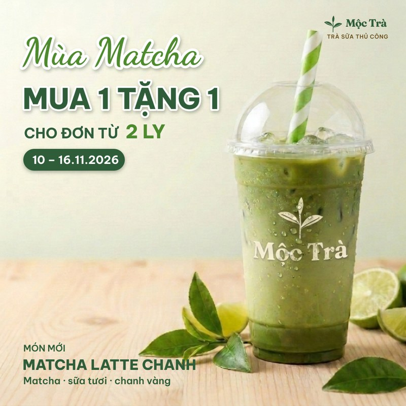
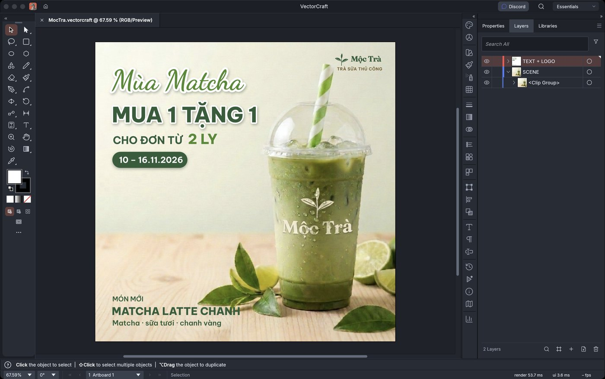
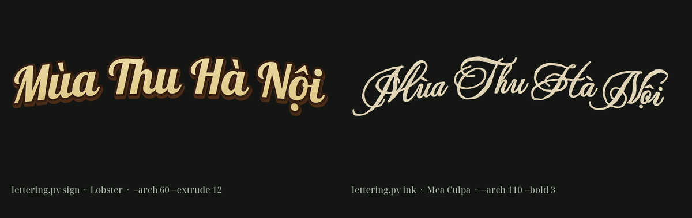
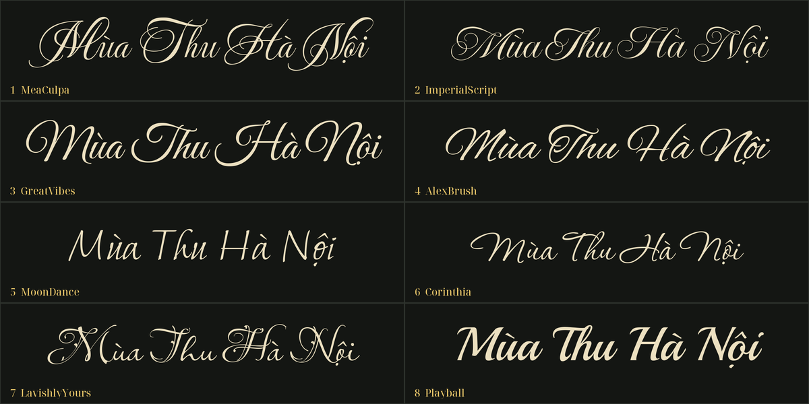

# design-ai-kit

**Tiếng Việt** · [English](README.en.md)

Dạy AI agent của bạn thiết kế ấn phẩm marketing mà khách hàng duyệt được: banner mạng xã hội, bài khuyến mãi,
poster, ảnh tổng kết sự kiện. Một skill duy nhất, đúc rút từ các vòng sửa thiết kế thật với khách.

Kit cung cấp cho agent:

1. **Quy trình làm việc** (`skills/design-ai/SKILL.md`): brief → tìm hiểu thương hiệu → chốt hướng thiết kế →
   tài sản (ảnh, logo) → dựng bằng script → tự kiểm tra → bàn giao → bổ sung bài học vào kit. Agent xin ảnh tham
   khảo từ sớm, đưa 2–3 hướng khi brief còn mơ hồ, kiểm tra lại ưu đãi và ngày tháng, không xuất file trước khi
   được duyệt, và sau khi duyệt thì đề xuất những gì job này nên thêm vào kit (example mới, quy tắc, lưu ý).
2. **Nguyên tắc thiết kế** (`references/principles.md`): các quy tắc rút ra từ những bản nháp bị trả về. Theo đúng
   phong cách của thương hiệu, ưu tiên tươi sáng hơn tối, một nguồn sáng, ưu đãi là nhân vật chính, không để khoảng
   trống thừa, logo phải được in *vào* ảnh sản phẩm.
3. **Dựng lại được bất cứ lúc nào**: file cấu hình JSON → tài liệu VectorCraft, chạy không cần mở giao diện; mỗi lần
   sửa chỉ là sửa cấu hình rồi chạy lại. Có `scripts/build_template.py` (bố cục phẳng với dải màu lượn sóng) và
   `scripts/scene_template.py` (một ảnh tràn viền kèm chữ, được cắt khít theo artboard). Cấu hình mẫu nằm trong
   `skills/design-ai/examples/`.
4. **Công cụ xử lý ảnh** (`scripts/image_tools.py`): đo vùng có nội dung của ảnh trong suốt, làm mờ mép, đồng bộ
   ánh sáng, ghép ảnh so sánh, chấm điểm vùng trống theo lưới, đo độ rộng chữ.
5. **Công thức tạo tài sản bằng AI** (`references/ai-assets.md`): ưu tiên ảnh stock; dùng AI để in logo lên sản
   phẩm, tạo hạt trang trí, sửa một chi tiết trong ảnh. Đã thử với Magnific MCP; model ảnh nào nhận được ảnh
   tham chiếu cũng dùng được.
6. **Font và chữ tiêu đề** (`references/fonts.md`, `scripts/lettering.py`): danh sách font đã kiểm đủ tiếng Việt,
   cách chọn font tiêu đề bằng bảng so sánh, và các hiệu ứng chữ mà engine không tự vẽ được (biển hiệu 3D, bút lông,
   uốn vòng cung).

## Minh hoạ

Một bài khuyến mãi dựng bằng `scene_template.py` (thương hiệu hư cấu, cảnh do AI tạo, logo in lên ly):



Cùng bản dựng đó mở trong VectorCraft: script tạo sẵn cây layer gọn gàng (SCENE cắt khít artboard, TEXT + LOGO
ở trên), nên designer có thể nhận lại và sửa tay tiếp:



Hiệu ứng chữ tiêu đề từ `lettering.py`: `sign` (tô chuyển màu, viền, khối nổi 3D) và `ink` (nét bút lông vẽ tay),
cả hai đều uốn cong:



Bảng font đúng như khách nhìn thấy: tám font script đủ tiếng Việt, đánh số, cùng một câu chữ, để khách chọn trong
một lượt:



## Cài đặt

```bash
git clone https://github.com/sparklabx/design-ai-kit
mkdir -p ~/.claude/skills && cp -r design-ai-kit/skills/design-ai ~/.claude/skills/          # Claude Code
mkdir -p ~/.gemini/config/skills && cp -r design-ai-kit/skills/design-ai ~/.gemini/config/skills/   # Antigravity
```

Agent khác: trỏ tới `skills/design-ai/SKILL.md`.

**Yêu cầu:** Python 3.9 trở lên (nếu thiếu Pillow/numpy, skill tự cài vào `~/.cache/design-ai/venv`), cùng một
engine, chọn theo thứ tự Illustrator › VectorCraft (`vectorcraft-cli`) › Photoshop. Nhánh Adobe
(`scripts/steps_to_svg.py` + `scripts/adobe.py`, macOS) chưa được thử trong ứng dụng thật; xem `references/adobe.md`.
Tuỳ chọn: một MCP tạo ảnh, hoặc Antigravity CLI `agy` (`scripts/agy_image.py` dùng công cụ tạo ảnh có sẵn trong gói
Google của bạn).

## Dùng thử

```bash
cd skills/design-ai
cp examples/promo-square.json my.json   # hoặc examples/scene-square.json với scripts/scene_template.py
# sửa my.json: đường dẫn tài sản, nội dung chữ, bảng màu, vị trí
python3 -E scripts/build_template.py my.json steps.json out.vectorcraft
vectorcraft-cli run --commands steps.json --export preview.png
```

## Giấy phép

MIT. Tên thương hiệu trong tài liệu chỉ là ví dụ; repo không chứa logo hay ảnh sản phẩm của bên thứ ba.
